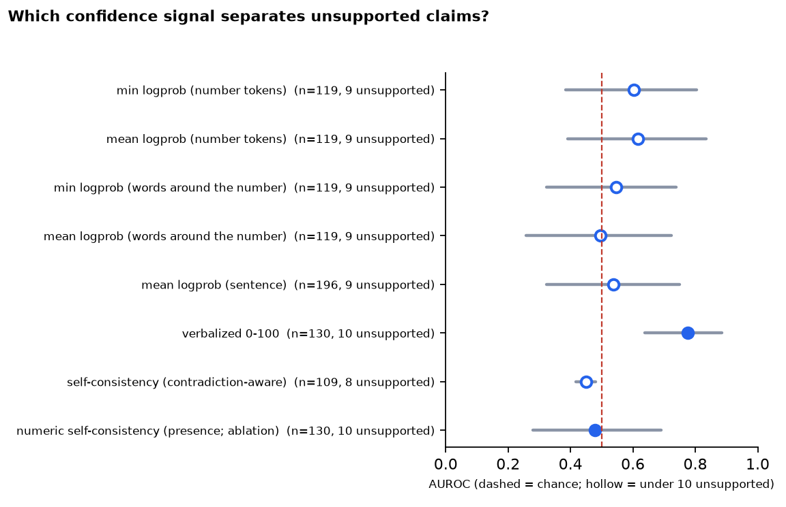
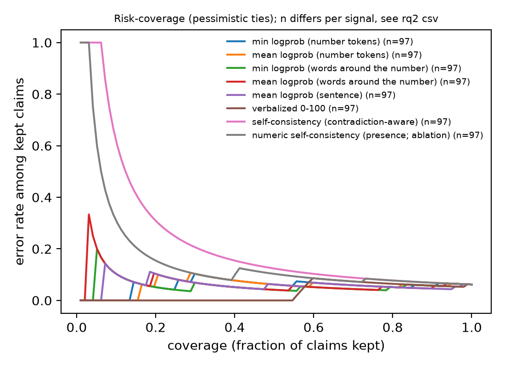
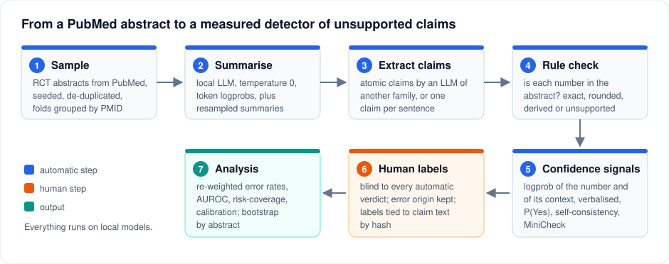

<div align="center">

# rct-numeric-claim-audit

### When an LLM summarises a clinical trial, does every number still point at the right thing?

A small, reproducible audit of **numeric-claim provenance** in LLM summaries of randomised-trial abstracts,
and a head-to-head test of which **confidence signal** can warn you when a claim is not supported.


-2563eb)


</div>

<p align="center">
  <a href="#the-idea">Idea</a> ·
  <a href="#results">Results</a> ·
  <a href="#how-it-works">How it works</a> ·
  <a href="#quick-start">Quick start</a> ·
  <a href="#reading-the-outputs">Reading the outputs</a> ·
  <a href="#limitations">Limitations</a>
</p>

---

## The idea

A summary can look careful and still be wrong in a way that no spell-checker or number-matcher will see:

> An abstract reports the diagnostic accuracy of two needle techniques, including a positive predictive value of 100% for one of them and a
> negative predictive value of 54.59% for the other. The model's summary says the first technique had the slightly higher *positive*
> predictive value, "100% compared to 54.59%".

Every number exists in the abstract, but 54.59% is a *negative* predictive value, so the claim compares the wrong quantities. Checking
"is this number in the source?" gives a false sense of safety, and that is the starting point of this project (an example from the first
labelled run; abstract text is not reproduced here, see [`DATA_STATEMENT.md`](DATA_STATEMENT.md)).

It asks three questions, always judged **against the abstract only** (not against clinical truth):

| | Question | Status |
|---|---|---|
| **RQ1** | How often are atomic claims in an LLM summary unsupported by the abstract, and in what way (wrong arm, wrong direction, invented number, overgeneralised)? | implemented, first labelled run done |
| **RQ2** | Which signal detects those claims: token log-probability, the model's own stated confidence, self-consistency across resamples, a yes/no verifier probability, or MiniCheck? | implemented, partly run |
| **RQ3** | If the abstract is edited (change a number, swap the arms, delete a result), does the summary follow the edit or the model's memory? | code and tests written, not run on real data |

It is an **evaluation study, not a new method**. It measures the specific models, prompts and abstracts listed in
[`configs/`](configs/config.toml) and makes no claim about "LLMs" in general.

> **Status.** The pipeline is complete and covered by offline unit tests, including an end-to-end run against a fake model.
> The results below come from a first run on 200 hand-labelled claims. Before citing a number, read [Limitations](#limitations):
> one annotator, few unsupported claims, and a few known loose ends (the P(Yes) signal has not yet been scored on this sheet, and the
> rule-based check still mishandles decimals written as `0·14` and European thousands separators like `149.983`).

## Results

<!-- RESULTS:START -->
<!-- generated by scripts/update_readme_results.py from results/rq1_local.csv and results/rq2_local.csv; do not edit by hand -->
**200 human-labelled claims, one annotator, judged against the abstract only.** Intervals are cluster bootstraps by abstract; AUROC higher = the signal ranks unsupported claims as less confident.

#### RQ1: how many claims are unsupported?

| Claim group | Unsupported rate | 95% CI | Labelled claims | Unsupported |
|---|---:|---:|---:|---:|
| Numeric, hard (percentages, decimals, comparisons) | 8.0% | 3.1%-13.7% | 100 | 8 |
| Numeric, easy (bare integers, p-values) | 6.7% | 0.0%-16.7% | 30 | 2 |
| Non-numeric | 0.0% | 0.0%-5.2% (Wilson) | 70 | 0 |
| **All claims** (re-weighted to the claim pool) | 2.6% | 1.1%-4.5% | 200 | 10 |

| Error type | Claims |
|---|---:|
| Misattributed | 8 |
| Direction-wrong | 2 |

Of the 126 claims the rule-based number check called *supported*, 7.1% were judged unsupported by the human labeller: the check sees whether a number is in the abstract, not what it is attached to.

#### RQ2: which confidence signal detects them?

| Signal | Claims | Unsupported | AUROC | 95% CI | Reading |
|---|---:|---:|---:|---:|---|
| min logprob (number tokens) | 119 | 9 | 0.60 | 0.38-0.80 | descriptive only (< 10 unsupported) |
| mean logprob (number tokens) | 119 | 9 | 0.62 | 0.39-0.84 | descriptive only (< 10 unsupported) |
| min logprob (words around the number) | 119 | 9 | 0.55 | 0.32-0.74 | descriptive only (< 10 unsupported) |
| mean logprob (words around the number) | 119 | 9 | 0.50 | 0.26-0.72 | descriptive only (< 10 unsupported) |
| mean logprob (sentence) | 196 | 9 | 0.54 | 0.32-0.75 | descriptive only (< 10 unsupported) |
| verbalized 0-100 | 130 | 10 | 0.78 | 0.64-0.88 | wide interval |
| P(Yes) verifier prompt | 25 |  | n/a | n/a | not enough labelled claims |
| self-consistency (contradiction-aware) | 109 | 8 | 0.45 | 0.42-0.48 | descriptive only (< 10 unsupported) |
| numeric self-consistency (presence; ablation) | 130 | 10 | 0.48 | 0.28-0.69 | wide interval |
| MiniCheck score | 0 |  | n/a | n/a | not enough labelled claims |



<!-- RESULTS:END -->

**How to read this.** "Unsupported" means any label other than *Supported* / *Derived-correct* (see the [label set](#6-human-labels)).
With fewer than 10 unsupported claims, an AUROC and its interval are *descriptive*: they show what the sample looks like, not a
finding. A very narrow interval next to a tiny sample (as for signals that give almost every claim the same score) comes from ties,
not from precision. The main conclusions this sample can support are of the kind "clearly above chance", "indistinguishable from chance"
and "the rule-based check cannot see misattribution". It cannot rank two signals that are close to each other.

<details>
<summary><b>Risk-coverage curves</b> (<code>results/rq2_local.png</code>)</summary>
<br>



Keep only the claims a signal is most confident about (x axis) and look at the error rate among them (y axis). A useful
signal's curve sits below the flat base rate at low coverage. Ties are broken pessimistically (errors first), so signals that give
many claims the same score look worse here than their AUROC suggests: that is deliberate, and it is why tie-heavy signals such as
self-consistency look so poor in this plot.

</details>

## How it works

<p align="center"></p>

### 1. Sample
RCT abstracts come from PubMed through the E-utilities API (rate-limited, polite). The sample is seeded and de-duplicated, only abstracts of
sensible length with at least a few numeric result tokens are kept, and cross-validation folds are grouped **by PMID** so claims from the same
abstract never straddle train and test. PMIDs go to [`data/manifest.csv`](data/manifest.csv); abstract text never leaves your machine, and anyone can
rebuild the exact sample with `rctaudit fetch --manifest data/manifest.csv`.

### 2. Summarise
A local model (served by LM Studio or llama.cpp through an OpenAI-compatible endpoint) writes a summary at temperature 0 with token log-probabilities,
then a few resampled summaries at temperature 0.7 for the self-consistency signal.

### 3. Extract atomic claims
A *different* model family splits each summary into short, self-contained claims, each tied to the summary sentence it came from (`span`).
The extractor is itself an LLM and makes its own mistakes, so the audit keeps two safeguards: claims that dropped half of a paired comparison are
flagged, and `--mode sentence` replaces the extractor with one claim per sentence (coarser, but no extractor errors by construction).

### 4. Rule-based numeric check
[`numcheck.py`](src/rctaudit/numcheck.py) asks: is each number in the claim *present* in the abstract, exactly, rounded to the summary's precision, as an
explicit n/N percentage, or only by arithmetic (`derived_candidate`, never auto-labelled)? It handles glued units (`14weeks`) and spelled-out numbers
(`seventy-two`). It deliberately knows nothing about *what* the number is attached to, so "supported" by the rule is an upper bound.
A null model measures how often a random number looks supported by chance; on a number-dense example abstract that was about 1% for one-decimal numbers
and about 10% for integers (`chance_match_rate`, tested in `tests/test_numcheck.py`), which is why integer-only claims are weighed separately.

### 5. Confidence signals
Each signal is a claim-level score for "this is supported". They fail in different ways, and the design anticipates it:

| Signal | What it measures | Known blind spot |
|---|---|---|
| `num_lp_*` | log-probability of the number's tokens while writing the summary | A misattributed number is copied correctly, so its probability is high. |
| `span_lp_*`, `bind_lp_*` | log-probability of the sentence, and of the 6 words on each side of the number, where the choice of arm or outcome is made | Fluency is not truth. |
| `verbalized` | the model is asked for a 0-100 confidence | Saturates at a handful of values, so ties dominate. |
| `p_yes` | P(Yes) / (P(Yes) + P(No)) from the next-token distribution for "does the abstract fully support this claim?" | Needs `top_logprobs` from the server (checked by `scripts/preflight.py`). |
| `sc_agree` | agreement across resampled summaries, counting **contradictions only** (an omitted number is not disagreement) | A systematic error is repeated in every sample and looks consistent. |
| presence-based self-consistency | fraction of resamples that contain the number | Ablation only; omissions look like errors. |
| MiniCheck | a fact-checking model's support score (Tang et al., EMNLP 2024) | Needs a GPU build of PyTorch. |

### 6. Human labels
Every label is judged blind to all automatic scores, against the abstract only, with one primary label per claim:

| Label | Meaning |
|---|---|
| `Supported` | Every number, direction and qualifier is in the abstract. |
| `Derived-correct` | Not stated, but follows by correct arithmetic for the right arms. |
| `Unsupported-number` | A number that appears nowhere and is not a valid derivation. |
| `Unsupported-claim` | A non-numeric statement the abstract does not make. |
| `Misattributed` | Numbers exist but sit on the wrong arm, outcome, time point or population. |
| `Direction-wrong` | Opposite direction or significance. |
| `Overgeneralized` | Stronger or broader than the abstract. |
| `Derived-wrong` | A derived number computed wrongly. |
| `Skip` | Not a claim (fragment); counted, not hidden. |

When a claim has two problems, the first of `Direction-wrong > Misattributed > Unsupported-number > Unsupported-claim > Derived-wrong > Overgeneralized` wins.
Full rules, edge cases and the test-retest protocol: [`annotation/GUIDELINES.md`](annotation/GUIDELINES.md).

Two details keep the labels trustworthy:
- **`error_origin`.** For every error the labeller says whether the *summary* is wrong or the *claim extractor* broke a correct sentence. Extractor-origin errors are
  excluded from the generator audit and counted separately.
- **`claim_sha`.** A claim's id is just its position in the extractor output, so a new extractor prompt gives the same id to a different claim. Exported labels carry a
  hash of the claim text, and `analysis/analyze.py` refuses to run if any label no longer matches its claim.

### 7. Analysis
[`analysis/analyze.py`](analysis/analyze.py) reports:
- **RQ1** error rates by claim group, with the all-claims rate **re-weighted** to the claim pool's mix of hard-numeric, easy-numeric and non-numeric claims (the label sheet over-samples hard numeric claims on purpose: 50 / 15 / 35%), and a **cluster bootstrap by abstract**.
- **RQ2** AUROC (average ranks for ties), risk-coverage and AURC, and calibration (Platt and isotonic, cross-fitted by abstract; ECE with few equal-mass bins). Each signal is reported on its own claims (`own`) and on the claims every signal covers (`common`); compare signals on `common`.
- **Honesty switches.** With fewer than 10 unsupported claims everything is flagged *descriptive*; the rule-based check is compared to the human labels with Cohen's kappa.

## Design lessons from the pilot

The first informal pass (43 abstracts, read against the abstracts without a full label protocol) showed that the obvious signals do not measure what their names suggest, so the design was
changed before the main run. This is why the repository looks the way it does:

- **The extractor can create errors.** In the pilot, most of the errors spotted by eye came from the claim extractor splitting "23% and 39%, respectively" into two claims, not from the summary. Hence `span`, `error_origin`, `dropped_pairing` and `--mode sentence`.
- **Self-consistency must count contradictions, not omissions.** The first version gave low scores to correct but unremarkable numbers (sample sizes) simply because resamples leave them out.
- **A copied number has a high logprob even when it sits on the wrong arm.** So the logprob of the words *around* the number was added.
- **Verbalised confidence barely varies**, so a continuous P(Yes) from the verifier prompt was added.
- **Easy claims dominate.** Most numeric claims are bare integers ("62 patients") that are almost always right; the label sheet therefore over-samples percentages, decimals and comparisons, and the all-claims rate is re-weighted.
- **PubMed `sort=pub_date` returns the newest articles first**, so a small pool is the most recent slice; set `per_year = true` in `[pubmed]` to span the whole window.

## Quick start

Everything runs on your own machine; no abstract is sent to a third-party API. Tested on Debian with an 8 GB GPU and LM Studio; GPU, server and MiniCheck setup is in
[`docs/SETUP_DEBIAN.md`](docs/SETUP_DEBIAN.md).

```bash
python3 -m venv .venv && source .venv/bin/activate
pip install -e ".[analysis,dev]"
cp .env.example .env                  # add NCBI_EMAIL (and NCBI_API_KEY if you have one)
python -m pytest                      # offline tests, no model or network needed
python scripts/preflight.py           # checks the local server, logprobs and P(Yes) support
```

Start a local OpenAI-compatible server (LM Studio on port 1235 by default), set the model ids in [`configs/config.toml`](configs/config.toml)
(the generator and the extractor must be different models, ideally different families), then run from the repository root:

```bash
rctaudit fetch --pool 200                                   # abstracts -> work/, PMIDs -> data/manifest.csv
rctaudit generate  --generator local --samples 3 --logprobs
rctaudit extract   --generator local                        # add --mode sentence for one claim per sentence
rctaudit verify    --generator local                        # add --minicheck if installed
rctaudit signals   --generator local
rctaudit labelsheet --generator local --n 200               # -> work/label_sheet_local.csv
```

Now label `work/label_sheet_local.csv` following [`annotation/GUIDELINES.md`](annotation/GUIDELINES.md) (columns `label`, `error_origin`, `notes`), then:

```bash
rctaudit verbalized --generator local --only-sheet work/label_sheet_local.csv
rctaudit pyes       --generator local --only-sheet work/label_sheet_local.csv
python scripts/export_labels.py                             # sheet -> annotation/labels_local.csv (no abstract text, with claim_sha)
python analysis/analyze.py --generator local                # -> results/rq1_local.csv, rq2_local.csv, rq2_local.png
python scripts/update_readme_results.py --generator local   # refreshes the Results section and docs/rq2_auroc.png
```

Prefer a single command? `python scripts/run_pipeline.py --pool 200 --name my_run` runs the automatic steps with per-step logs and archives the run directory.

**Reproduce a published sample** from its PMIDs: `rctaudit fetch --manifest data/manifest.csv`.
**Safety rails:** a second `fetch` that would replace a sample with unfinished stage files is refused (`--force` archives them to `work/_archive_<time>/`),
every stage stops if `work/` mixes two samples, and `export_labels.py` never overwrites existing labels without `--force`.

### Command reference

| Command | What it does | Writes |
|---|---|---|
| `rctaudit fetch` | download and sample abstracts | `work/abstracts.jsonl`, `data/manifest.csv` |
| `rctaudit generate` | summaries (+ logprobs, + resamples) | `work/summaries_*.jsonl`, `work/samples_*.jsonl` |
| `rctaudit extract` | atomic claims (`--mode llm` or `sentence`) | `work/claims_*.jsonl` |
| `rctaudit verify` | rule-based number check (+ MiniCheck) | `results/numeric_*.csv` |
| `rctaudit signals` | logprob and self-consistency signals | `results/signals_*.csv` |
| `rctaudit labelsheet` | stratified claim sample for labelling | `work/label_sheet_*.csv` |
| `rctaudit verbalized` / `pyes` | verbalised confidence / P(Yes) | `results/verbalized_*.csv`, `results/pyes_*.csv` |
| `rctaudit rq3` | counterfactual abstract edits (optional) | `work/rq3_*.jsonl` |
| `python scripts/export_labels.py` | public, hashed labels | `annotation/labels_*.csv` |
| `python analysis/analyze.py` | RQ1 and RQ2 tables and figure | `results/rq1_*.csv`, `rq2_*.csv`, `rq2_*.png` |
| `python scripts/update_readme_results.py` | fill the Results section from the CSVs | `README.md`, `docs/rq2_auroc.png` |

## Reading the outputs

There is no dashboard: the outputs are plain CSV files and two figures, all aggregate and safe to share. This is how to read them.

| File | One row per | Look at |
|---|---|---|
| `results/rq1_<gen>.csv` | quantity | `unsupported_rate_*` (estimate, `ci_lo`, `ci_hi`, `n`); `share_<label>` for the error mix; `rule_supported_but_human_unsupported` for the blind spot of the rule check; `claims_excluded_extractor_origin` |
| `results/rq2_<gen>.csv` | signal x subset | `auroc` with `auroc_lo`/`auroc_hi`; `aurc` and `risk@80%cov` (lower is better); `ece_platt`/`ece_isotonic`; `note` (flags *descriptive* results and missing signals); `subset` = `own` or `common` |
| `results/signals_<gen>.csv` | claim | the raw signals (`num_lp_*`, `bind_lp_*`, `sc_agree`, ...) |
| `results/numeric_<gen>.csv` | claim | rule verdict (`supported`, `derived_candidate`, `unsupported`, `no_numbers`) and the numbers it could not find |
| `results/rq2_<gen>.png`, `docs/rq2_auroc.png` | | risk-coverage curves; AUROC per signal with intervals |

A short checklist before trusting a number: how many unsupported claims are behind it (`n_unsupported`)? Does the interval cross 0.5? Is the row `own` or `common`?
Is the note saying *descriptive*? If the answer to the last question is yes, quote it as an observation, not a finding.

## Limitations

- **Small human-labelled sample, one annotator.** Only a handful of claims are unsupported, so intervals are wide and calibration uses few bins. A second annotator, even on a subset, and a test-retest on 30 claims after 48 hours are the main upgrades; more unsupported claims (more hard numeric claims, or a weaker generator) are needed before ranking signals.
- **Few models.** One small local generator and one small local extractor; results are about those models, not about "LLMs". The code refuses identical generator and extractor ids; choosing different *families* is up to you.
- **The extractor is an LLM** and can introduce errors; the audit measures and separates them (`error_origin`, `dropped_pairing`, `--mode sentence`) but does not eliminate them.
- **Signals cover different claims.** Number-level signals exist only for claims with numbers; compare signals on the `common` subset.
- **The rule-based check is weak for small integers** and blind to misattribution; it is a recall tool for invented decimals and percentages, not a verifier. Known gaps right now: decimals written with a middle dot (`0·14`) and European thousands separators.
- **Abstracts only, RCTs only, English only.** Abstracts may omit numbers that the full paper reports, and the audit judges support by the abstract, not clinical truth.
- **PubMed sampling window.** Newest-first sampling over a window gives a recent slice unless `per_year = true`.
- **RQ3 scoring is heuristic** (number and order matching) and must be hand-checked on a subset.
- **Not a novelty claim.** Faithfulness checking and calibration of LLM summaries are active research areas; this is a small audit with open code and a public protocol. Related work: MiniCheck (Tang, Laban, Durrett, EMNLP 2024), EBM-NLP (Nye et al., ACL 2018).

## Repository layout

```
configs/config.toml            all experiment settings (seeds, models, PubMed window, thresholds)
prompts/                       summarise, extract claims, verbalised confidence, P(Yes) verifier
src/rctaudit/                  numcheck, claims, confidence, metrics, splits, edits, llm, pubmed, sample, pipeline, cli
analysis/analyze.py            RQ1 / RQ2 statistics and figures
scripts/                       preflight, run_pipeline, export_labels, update_readme_results
annotation/GUIDELINES.md       label rules and test-retest protocol (labels_*.csv holds the public, hashed labels)
data/manifest.csv              PMIDs and seeds of the sample (no abstract text)
results/                       aggregate tables and figures
docs/                          setup guide, README figures
tests/                         offline unit tests and an end-to-end run against a fake model
```

## Data, ethics, reproducibility

- Fixed seeds, a PMID manifest, a content-hashed request cache, resumable stages, and offline tests (`python -m pytest`).
- Abstract text, summaries and the label sheet stay local and git-ignored; see [`DATA_STATEMENT.md`](DATA_STATEMENT.md). No patient data is involved.
- Labels are by the repository author.

## Citation and license

Cite via [`CITATION.cff`](CITATION.cff). Released under the [MIT License](LICENSE).
